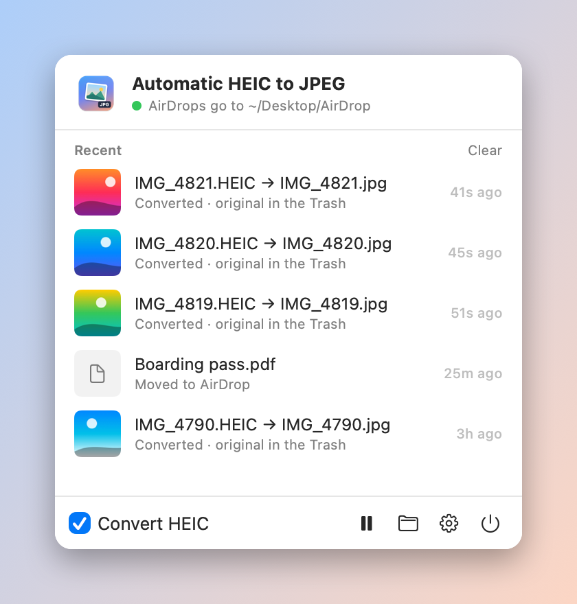
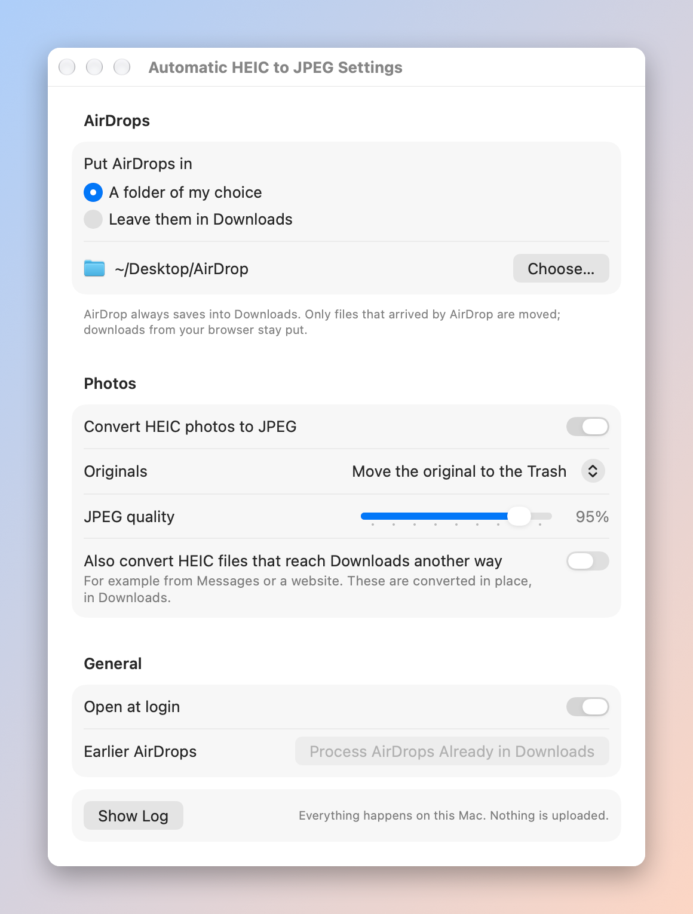
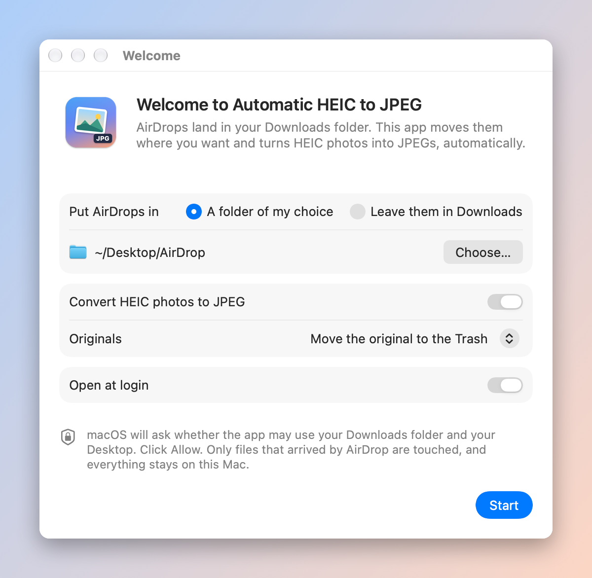

# Automatic HEIC to JPEG

A small Mac menu bar app that tidies up AirDrop. Everything you AirDrop to
your Mac goes into a folder you choose (for example a new **AirDrop** folder
on your Desktop) instead of being mixed in with your downloads, and photos
arrive as JPEGs instead of HEIC.

## Why I built it

I shoot HEIC on my iPhone because it gives the best quality, but eBay and
plenty of other sites still don't accept it. I kept AirDropping photos to my
Mac, digging them out of Downloads and converting them by hand before I could
upload them anywhere. Now they just show up as JPEGs in their own folder,
ready to use.



## What it does

- **Spots AirDrops.** Only files that arrived by AirDrop are touched. Things
  you download in your browser stay exactly where they are.
- **Moves them where you want.** Pick any folder (the default is
  `~/Desktop/AirDrop`), or leave AirDrops in Downloads and only convert them.
- **Converts HEIC to JPEG.** Photos keep their date, camera details,
  location, orientation and colour profile. iPhone HDR photos stay HDR (the
  gain map is carried over), and the file dates match the original.
- **Your choice of what happens to the original HEIC:** move it to the Trash,
  keep it beside the JPEG, or keep it in an `Originals` folder. It is never
  deleted permanently. "Trash" means the Trash, so Finder's **Put Back**
  still works.
- **Shows what it did.** The menu bar panel lists the last 20 files. Click
  one to show it in Finder.
- **Optional:** also convert HEIC files that reach Downloads some other way,
  such as from Messages or a website (off by default; these are converted in
  place).



## Install

1. Download `Automatic-HEIC-to-JPEG-1.0.0.dmg` from the
   [latest release](https://github.com/rsmith4321/automatic-heic-to-jpeg/releases/latest).
2. Open it and drag **Automatic HEIC to JPEG** into Applications.
3. Open the app. It is signed and notarized by Apple, so it opens normally.

The first time it runs, a short setup window asks where AirDrops should go
and what to do with the originals.



When you click **Start**, macOS asks whether the app may use your Downloads
folder (and your Desktop, if that's where AirDrops are going). Click **Allow**.
If you click Don't Allow by mistake, the menu bar panel says so and has a
button that opens **System Settings → Privacy & Security → Files & Folders**,
where you can turn it on.

AirDrops that were already in Downloads before you set it up are left alone.
The panel offers a one-time **Process Now** if you'd like those handled too.

You need macOS 14 (Sonoma) or later, on an Apple silicon or Intel Mac.

## Using it

The photo icon in the menu bar opens the panel:

- The status line shows where AirDrops are going.
- **Recent** lists what happened. Click a row to reveal the file.
- **Convert HEIC** turns conversion on or off quickly.
- The buttons pause it, open the AirDrop folder, open Settings, and quit.

If something needs attention, such as a missing permission or a destination
on a drive that isn't plugged in, the panel says so. AirDrops wait in Downloads
until it's sorted out, so nothing gets lost.

**Settings** also has the JPEG quality (95% by default), **Open at login**
(on by default), **Process AirDrops Already in Downloads**, and **Show Log**
(`~/Library/Logs/Automatic HEIC to JPEG.log`).

## How AirDrop detection works

macOS AirDrop always saves incoming files into `~/Downloads`. Like anything
downloaded, each file gets a `com.apple.quarantine` extended attribute that
records which program saved it, in the form `flags;time;agent;id`. For
AirDrop the agent is `sharingd`, the system's sharing service. Browsers write
their own names (`Safari`, `Google Chrome`, and so on).

You can see it yourself in Terminal:

```bash
xattr -p com.apple.quarantine ~/Downloads/IMG_1234.HEIC
```

An AirDropped photo prints something like `0081;6ad2c4b4;sharingd;C1B1…`.

The app watches `~/Downloads` for changes, and for each new item:

1. Skips it unless its quarantine agent is `sharingd` (or it's a HEIC and you
   turned on "convert HEIC that reach Downloads another way").
2. Waits until the file has stopped changing (same size and date on two
   looks, untouched for two seconds), so half-received files are never moved.
3. Converts HEIC with Apple's ImageIO into a hidden temporary file, reads the
   JPEG back to check it, then renames it into place. If anything fails, the
   original is kept (moved as is to your AirDrop folder, or left in
   Downloads) and the failure is listed in the panel.
4. Handles the original as you chose: Trash, beside the JPEG, or `Originals`.
5. Never overwrites: if `IMG_1234.jpg` already exists the new one is
   `IMG_1234 2.jpg`.

Files that arrived before setup are counted, not touched, until you ask.

## Privacy

Everything happens on your Mac. The app makes no network connections, has no
analytics or update checks, and doesn't collect anything. It reads only your
Downloads folder and writes only to the folder you picked (and the Trash).

## Build from source

You need Xcode or Apple's command line tools (`xcode-select --install`).

```bash
git clone https://github.com/rsmith4321/automatic-heic-to-jpeg.git
cd automatic-heic-to-jpeg
./build.sh
```

`build.sh` builds a universal app, signs it (with your Developer ID if you
have one, otherwise an ad hoc signature that's fine for your own Mac), copies
it to `/Applications` and starts it. `./build.sh --release` also notarizes it
and makes a DMG and a zip in `build/`; it needs a Developer ID and a
`notarytool` keychain profile named in `NOTARY_PROFILE`.

Other tools:

- `Tools/selftest.sh` runs the file handling against temporary folders with
  generated HEIC photos and faked AirDrop and browser tags: conversion,
  metadata, collisions, half-received files, broken files, every originals
  option, earlier AirDrops and a missing destination.
- `Tools/make-icon.sh` redraws the app icon.
- `Tools/docshots.sh` re-renders the screenshots in `docs/` off screen.

The app is three Swift files: [`Sources/Core.swift`](Sources/Core.swift)
(detection and conversion, no UI), [`Sources/Model.swift`](Sources/Model.swift)
(settings and the folder watcher) and the SwiftUI views in
[`Sources/Views.swift`](Sources/Views.swift) and [`Sources/App.swift`](Sources/App.swift).

## Uninstall

Quit it from the panel, drag it from Applications to the Trash, and if you
like remove its settings with `defaults delete io.github.rsmith4321.automatic-heic-to-jpeg`.
Your AirDrop folder and JPEGs stay where they are.

## Prior art and thanks

I looked for something that already did this before building it. These are
the closest, and each one helped:

- [Plink](https://nicklafferty.com/products/plink/) by Nick Lafferty, an
  open-source menu bar app that converts HEIC to JPG with ImageIO when you
  drop files on it or use a Finder Quick Action. Great for converting by
  hand; it doesn't watch for AirDrops.
- [heic2jpg](https://pkg.go.dev/github.com/hirune05/heic2jpg), a Go command
  line tool that wraps `sips` and can watch a folder such as Downloads. It
  converts every HEIC there and doesn't tell AirDrops apart or move them.
- [Change the destination directory of AirDrop on macOS](https://dev.to/louy2/change-destination-directory-of-airdrop-on-macos-472h),
  a write-up on using the `sharingd` quarantine tag with a Folder Action to
  move AirDrops. That's the detection trick this app is built on.

Nothing I found combined AirDrop detection, a destination folder and HEIC
conversion in one app, so I made this.

## License

[MIT](LICENSE). Copyright (c) 2026 Ryan Smith.
